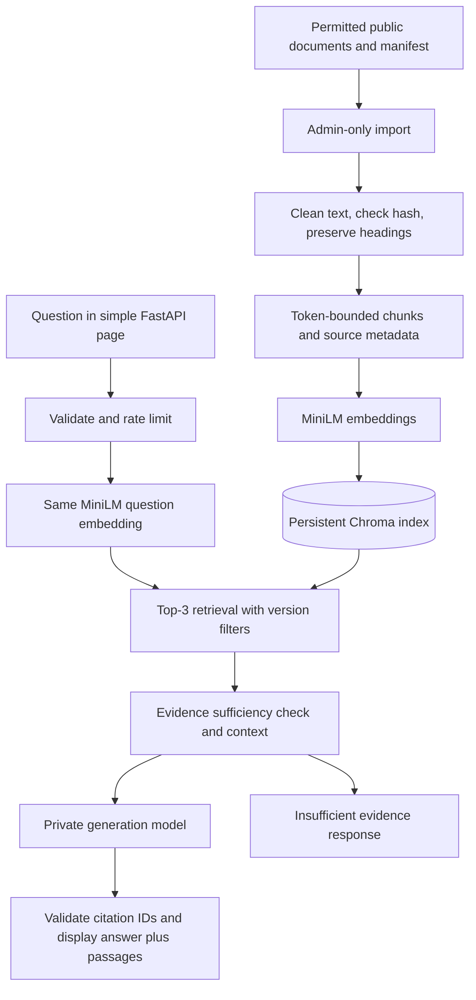

**NJIT IS373 · Review 1 — Plan · Combined individual project record**

Prepared 2026-11-16. Submission deadline supplied in the assignment request:
2026-11-17, 1 PM Eastern; Canvas remains the authority. This is one evolving
individual record, separate from any shared group record.

**Status and authorship:** Research and this plan were drafted with AI assistance
at the owner's request. Source observations and local checks below were performed
by AI; they are not claims of independent student research, peer feedback, or
personal reflection. Decisions are provisional proposals made under the request
to complete Plan using reasonable choices. Existing learner explanations in
[LEARNING](../../LEARNING.md) remain unchanged. Earlier conversations are available
only through the existing repository records. Private career reflection is excluded.

**Research-review index**

| Requirement | Evidence | Status on 2026-11-16 |
|---|---|---|
| Portfolio research | [Three employers](#employer-postings), [career comparison](#career-comparison) | Original pages observed; fit is provisional |
| Portfolio design | [Reader, evidence map and layouts](#portfolio-design) | Planned |
| Portfolio review | [Peer question and next steps](#portfolio-next) | Human feedback pending |
| Technical research | [Primary sources](#technical-sources), [alternatives](#technical-comparisons) | Sources observed; experiment planned |
| RAG design | [Architecture](#architecture), [five stories](#observable-stories) | Planned |
| Corpus and trace | [Permission manifest](#source-manifest), [sample trace](#proposed-trace) | Pages observed; import/retrieval/generation not run |
| Evaluation | [Five questions](#evaluation-plan) | Expected results only |
| Hosting | [Resource plan](#hosting-and-resources) | Local server records inspected; current hosted state unverified |
| Verification | [Actual checks](#actual-checks) | Observed locally on existing APP-003 code |

Course sources, accessed 2026-11-16:
[portfolio brief](https://kaw393939.github.io/is373-studio/projects/portfolio.html),
[RAG brief](https://kaw393939.github.io/is373-studio/projects/individual.html), and
[research-review index/template](https://kaw393939.github.io/is373-studio/templates/project-record.html#research-review-index).
The published template includes “Individual” in both project headings; this record
uses the two exact headings explicitly requested for this submission. Both identify
individual work. Confirm the wording against Canvas before submitting.

## 1. Portfolio + career research

### Sources and source index

<a id="employer-postings"></a>
All three original employer pages below were fetched and read on **2026-11-16**.
Each displayed an Apply action and no closed notice at access. This verifies the
posting's presence, not a guaranteed vacancy, eligibility, or an application.
Lever is Palantir's employer application host, not a job-board repost.

#### J1 · Palantir — Forward Deployed Software Engineer, New Grad - Warp Speed

[Original posting](https://jobs.lever.co/palantir/66b495eb-aaf9-4bf9-a759-41854534add7)

- Location/type: New York, NY; full-time, on-site.
- Eligibility/required: U.S. Person; graduation December 2026 or Spring 2027;
  strong engineering background and coding proficiency (examples include Python
  and Java); willingness to travel up to 25% with flexibility described in the posting.
- Preferred/valued: listed engineering-related fields; analytical problem solving,
  interest in large datasets, collaboration across technical/nontechnical teams.
- Three responsibilities: collaborate on system design; build applications around
  customer needs; work directly with customer stakeholders.
- Existing evidence: [ShiftBoard scope](../../SPEC.md#app-001--branded-homepage)
  and [account routes](../../app/features/accounts.py) show a bounded user problem
  translated into an application. AI assistance is disclosed in LEARNING.
- Gap: no verified external customer delivery or large-scale data project here.
- Next action, **2026-11-18 (planned):** rehearse a three-minute ShiftBoard problem,
  design and test explanation with a real peer, then record their actual question.
- Fit assumption: May 2027 matches the graduation window; U.S. Person status,
  travel suitability and whether the IT degree meets expectations remain unverified.

#### J2 · Amazon — Software Development Engineer, Amazon Leo, Early Career - 2026

[Original posting, ID 10513110](https://www.amazon.jobs/en/jobs/10513110/software-development-engineer-amazon-leo-early-career-2026)

- Location: Redmond, Washington; location preference is not guaranteed.
- Eligibility/required: age 18+; enrolled/completed related STEM bachelor's or
  higher degree; programming experience; data structures, algorithms and/or OOP.
  Export-control eligibility is limited to U.S. citizens/nationals, permanent
  residents, refugees or people granted asylum. Personal eligibility is unverified.
- Preferred: technical internship or project work; AI development tools, cloud
  (especially AWS), databases, debugging or version control; analytical and
  communication skills, adaptability and SDLC knowledge.
- Three responsibilities: build cloud/distributed services; review code and write
  technical documentation; participate in CI/CD and operational troubleshooting.
- Evidence: [account tests](../../tests/test_accounts.py),
  [role tests](../../tests/test_roles.py), and [CI definition](../../.github/workflows/check.yml).
- Gap: classroom CI and SQLite do not demonstrate distributed-system operation,
  AWS experience or production on-call work.
- Next action, **2026-11-19 (planned):** diagram one API failure path and explain
  its test and recovery behavior in the ShiftBoard case study.
- Fit assumption: IT may qualify as a related STEM field; the posting's 2026 title
  does not establish an acceptable May 2027 start date. Verify with recruiting.

#### J3 · Stripe — Software Engineer, New Grad

[Original posting, ID 8128744](https://stripe.com/careers/listing/software-engineer-new-grad/8128744)

- Locations/type: New York, Seattle, South San Francisco HQ; full-time; generally
  at least 50% in-office, with team-specific variation.
- Required/eligibility: related bachelor's/master's by summer 2027 or equivalent
  experience; at most 18 months professional experience excluding internships;
  programming/classwork, internship or collaborative coding experience, learning
  unfamiliar systems, clear communication, and critical validation of AI output.
- Preferred: technical specialization, code review and safe production updates,
  large-codebase familiarity, independent small-project ownership and peer work.
- Three work expectations (paraphrased from qualification text; the page has no
  separate responsibilities list): explain work to stakeholders; learn unfamiliar
  systems with collaborators; review and validate AI-assisted development outputs.
- Evidence: [documented checks and scoped implementation](../../SPEC.md),
  [security tests](../../tests/test_security.py), and [PR #6](https://github.com/Singh01113/my-app-studio/pull/6).
- Gap: multi-person coding contribution is not established by solo AI-assisted
  work. A group contribution needs a real commit/PR and explicit ownership.
- Next action, **2026-11-20 (planned):** select a real group contribution and link
  its review evidence; leave the case study pending if none is available.
- Fit assumption: graduation timing aligns; related-degree acceptance, work
  authorization and experience eligibility still require confirmation.

### Research comparisons

<a id="career-comparison"></a>
| Direction | Employer evidence and required skills | Accessibility and present evidence | Main gap |
|---|---|---|---|
| Forward Deployed / AI Engineering | J1: code plus customer discovery, design and delivery using business data; stakeholder communication | A genuine new-grad route exists. ShiftBoard supports a small problem-to-application story; RAG is only planned | Customer ambiguity, data integration, evaluated AI behavior; eligibility/travel constraints |
| Backend / Platform Software Engineering | J2/J3: programming fundamentals, maintainability, review, CI, operational reasoning; specialization grows from a general foundation | Current FastAPI, SQL-backed sessions, server-side permissions and tests are directly inspectable. J3's graduation window is relevant | Distributed systems, operational scale and verified human collaboration |

### Decisions and reasoning

**Provisional target: junior backend/software engineering, with security-conscious
API work and a developing AI application case study.** This is an AI-assisted
professional positioning proposal, not a private reflection or claim of job
qualification. J2/J3 responsibilities map more directly to existing inspectable
work than J1's external customer ownership. Keep FDE/AI engineering as an adjacent
path; the RAG project should add evidence of retrieval, evaluation and explaining
limits, rather than relabeling the existing app as an AI product.

Assumptions: employer readers value inspectable tests and scoped explanations;
one small assessed application can introduce relevant skills but cannot prove
production-scale expertise. A peer's ability to identify the target role and
explain one linked test is the next check of this positioning.

### Project plan/design

<a id="portfolio-design"></a>
**Target reader:** a recruiter or junior-engineer hiring manager reviewing backend
candidates. In about a minute, the reader should identify the role direction,
find one API/security example, and open code and test evidence without logging in.

| Employer responsibility | Real evidence | Portfolio decision |
|---|---|---|
| J1: translate user needs into an app | [ShiftBoard brand/config](../../app/brand.json), [SPEC](../../SPEC.md) | Explain visitor/problem, bounded scope and a design revision; do not claim client employment |
| J2: maintain services and review code | [accounts](../../app/features/accounts.py), [tests](../../tests/test_accounts.py) | Feature authentication flow, negative tests and logout revocation |
| J2: CI and operational discipline | [app CI](../../.github/workflows/check.yml), [Server Studio SPEC](https://github.com/Singh01113/my-server-studio/blob/main/SPEC.md) | Separate local checks, CI configuration and historically recorded deployment evidence |
| J3: validate AI-assisted outputs | [roles](../../app/features/roles.py), [tests](../../tests/test_roles.py), [LEARNING disclosure](../../LEARNING.md) | Explain current-database authorization and disclose assistance; never imply unaided authorship |

Content outline (planned):

| Content | Intended content and evidence |
|---|---|
| Homepage | Professional introduction, provisional backend direction, two featured project cards, visible GitHub link |
| About | Public brief supplied for this assignment: NJIT IT student, expected May 2027 graduation; interest in backend, security and AI. No private reflection |
| Skills | Python/FastAPI, SQL, HTML/CSS and Git supported by this app; Java, Docker, Linux and basic cybersecurity from the supplied brief, with server links where applicable. No proficiency ratings |
| Projects | ShiftBoard implementation; this individual portfolio's research-to-layout case study; Cybersecurity Knowledge Assistant marked Plan; Server Studio deployment of a supplied image explicitly credited as such |
| Group case study | Pending actual project URL, own contribution, commit/PR and review evidence. Do not publish team achievements as solo work |
| Resume | Pending owner-supplied, reviewed PDF; hide download control until a real file exists |
| Contact | Verified [GitHub profile](https://github.com/Singh01113) as interim professional route; no invented email/LinkedIn. Add owner-approved contact details during Build |

Two bounded layouts using the same content:

| Layout | Benefit | Cost | Decision |
|---|---|---|---|
| Single public page with anchored About, Skills, Projects, Resume, Contact | Fast scan; few routes; fits existing Jinja/CSS; direct links to detailed GitHub evidence | Long case studies can overwhelm the page | **Select** concise project cards linking detailed records |
| Separate Home/About/Projects/Resume/Contact pages | More room for case studies and individual URLs | More navigation and templates to maintain for a small initial body of work | Reconsider after real content outgrows the page |

Sketch: `identity + target role → featured ShiftBoard/RAG cards → evidence-linked
skills → About → Resume/contact`. Desktop cards side by side; narrow view stacks
cards. Reuse readable spacing, focus styles and restrained colors; keep the
personal portfolio distinct from ShiftBoard's product identity. Proposed public
route `/portfolio`; retain ShiftBoard `/` and every account/admin route. Proposed
`/assistant` route presents RAG separately. Neither route exists yet.

Three planned portfolio checks: (1) anonymous reader identifies target role and
opens a real project link; (2) keyboard user reaches all links with visible focus;
(3) at 390px width content fits without horizontal overflow and pending resume/demo
items are honest text, not broken buttons. Human results remain pending.

### Evidence and links

Observed local app revision: `07f7f82e9da17647f699d1053c286bc7ee0395da` on main,
matching remote HEAD via SSH on 2026-11-16. Git history contains merges of
[PR #2](https://github.com/Singh01113/my-app-studio/pull/2),
[PR #4](https://github.com/Singh01113/my-app-studio/pull/4) and
[PR #6](https://github.com/Singh01113/my-app-studio/pull/6).
Older SPEC/LEARNING prose still says APP-003 GitHub completion is pending; that
historical prose is preserved. Local merge history is evidence of the commit,
not fresh verification of issue closure or CI success.

Current code implements branding, signup/login, private dashboard, logout/session
revocation and member/admin authorization. It does **not** implement workplace
messages, scheduling, portfolio pages or RAG. Instructor screenshots under
`docs/review/assets` are not submitted as screenshots of this learner's app.

### Changed

Created this combined record because the tracked-file inventory contained no
individual portfolio/RAG record; linked it from README and SPEC. No application,
security helper, tests, group work, Studio evidence or deployment configuration changed.

### Checked

Three original employer pages and all three course pages were read. Local source,
test and Git history inspection supports the evidence mapping. Full existing
application checks passed; see [exact results](#actual-checks). The proposed
portfolio has not been built or inspected in a browser.

### Next

<a id="portfolio-next"></a>
**Peer-review question:** “Does the featured ShiftBoard work support junior backend
engineering as my target role? Open one linked test, tell me what skill it supports,
and identify one claim whose evidence is missing.”

**Peer/date/feedback: Pending.** No person has supplied feedback in this task.
Record their actual question, response, change and retest here using the existing
issue workflow; AI review is not a substitute. Before submission, review this
provisional role choice and the heading difference noted above. By 2026-11-20,
complete the dated employer actions, choose public resume/contact details and
supply the real group contribution. Build target from the course brief: Nov 24;
checked hosted release Dec 3; improvement Dec 10, subject to Canvas.

## 2. RAG app + technical research

### Sources and source index

<a id="technical-sources"></a>
Research question: **Can a small, persistent retrieval system answer introductory
cybersecurity questions with inspectable evidence and decline questions outside
five permitted public documents?** Intended users are students and small-business
technology learners seeking explanations, not incident diagnosis or current
vulnerability intelligence.

All sources below accessed **2026-11-16**, with readable original content observed
through web retrieval or direct HTTPS fetch. Package/model installation and
compatibility have not been tested.

| ID | Primary source | Observation used in the plan |
|---|---|---|
| T1 | [Lewis et al., RAG paper](https://arxiv.org/abs/2005.11401) | Retrieval supplies external evidence to generation; a chat UI alone proves no retrieval |
| T2 | [Chroma Python clients](https://docs.trychroma.com/reference/python/client) | PersistentClient stores on disk for local development/testing; server-backed deployment is preferred for production |
| T3 | [Chroma metadata filtering](https://docs.trychroma.com/docs/querying-collections/metadata-filtering) | Query filters can restrict records by metadata |
| T4 | [pgvector project documentation](https://github.com/pgvector/pgvector) | PostgreSQL vector extension offers exact search and optional HNSW/IVFFlat approximate indexes |
| T5 | [Neo4j graph concepts](https://neo4j.com/docs/getting-started/appendix/graphdb-concepts/) | Nodes represent entities; typed, directed relationships connect them; properties retain details |
| T6 | [all-MiniLM-L6-v2 model card](https://huggingface.co/sentence-transformers/all-MiniLM-L6-v2) | Apache-2.0 embedding model; 384 dimensions; default truncation beyond 256 word pieces |
| T7 | [Qwen2.5-1.5B-Instruct model card](https://huggingface.co/Qwen/Qwen2.5-1.5B-Instruct) | Small Apache-2.0 instruction model candidate; quality on this corpus unmeasured |
| T8 | [Ollama generation API](https://docs.ollama.com/api/generate) | Local HTTP generation endpoint with prompt and generation controls; proposed runtime only |
| T9 | [NIST reuse policy](https://www.nist.gov/open/license) | Federal-authored works differ from third-party materials; retain attribution and restrictions |
| T10 | [17 USC 105, Copyright Office](https://www.copyright.gov/title17/92chap1.html#105) | U.S. government-work copyright basis; does not grant rights to third-party content on government sites |

### Research comparisons

<a id="technical-comparisons"></a>
RAG means retrieving passages relevant to a question, then asking a generation
model to answer using those passages. The retriever can miss the right evidence;
the generator can still invent claims. Citations must point to supporting text,
not merely to a thematically related page. Neither similarity nor an attached
citation establishes truth.

A **chunk** is a bounded piece of cleaned source text retaining its heading and
location. An **embedding** represents that text numerically for similarity search;
the question uses the same embedding model and configuration. A **vector database**
stores/searches these representations with IDs and metadata. Keyword retrieval
matches terms and is an inexpensive, inspectable baseline, but can miss paraphrases.
Semantic retrieval may find different wording, but can return related yet irrelevant
text and needs measured evaluation.

A **graph database** instead makes entities and relationships explicit. Entity
extraction identifies concepts such as Password, MFA, SecurityKey and Account;
normalization resolves synonyms such as “multi-factor” and “MFA.” A candidate
relationship is `SecurityKey --USED_FOR--> MFA`, supported by NIST C05's passage.
Each edge would need source document/version/section provenance and review;
automatic extraction can invent edges. Graph traversal can explain relationships
but does not replace source passages or generate an answer by itself. A hybrid
would combine graph paths and vector passages, with more import/evaluation work.

| Option | Useful capability | Practical cost for this app | Decision |
|---|---|---|---|
| Chroma vector retrieval | Python client, persisted chunks/vectors/metadata, filtered retrieval | Additional package and data directory; embedded mode needs disciplined single-process use and a persistence check | **Choose for bounded local prototype**, with hosted mode gated on capacity/reliability review |
| PostgreSQL + pgvector | SQL joins/constraints plus vector search; familiar relational model | New database service, credentials, migrations and backups alongside existing SQLite | Good later option if a managed/existing PostgreSQL service becomes available |
| Neo4j graph retrieval | Explicit relationship paths and provenance properties | New service, Cypher/schema and verified entity/edge extraction; five short documents offer limited payoff | Research alternative; not implemented |
| Vector + graph hybrid | Complementary semantic and relationship evidence | Two representations and more failure modes to evaluate | Defer until evaluation demonstrates a need |

Bounded experiments (all **planned**, same five sources and five questions):

| Choice | A | B | Initial choice and next check |
|---|---|---|---|
| Retrieval | Lowercased keyword overlap ranking, same top-3 cutoff | MiniLM cosine retrieval, top 3 | B for paraphrases; compare hit@3, irrelevant chunks and latency against A |
| Chunk boundary | Up to 120 embedding-token word pieces, 20 overlap | Up to 220, 30 overlap | B preserves explanatory context; include heading within limit and never exceed the model's 256-piece input limit. Compare evidence completeness and duplicate hits |
| Metadata filter | All permitted active source versions, archived status displayed | Only non-archived pages | A for this explicitly historical teaching corpus; B exposes coverage loss. Questions about current policy must abstain when only archived evidence exists |

Freeze model revision, normalization, query set and top-k while changing one
variable. Manually label expected passages before running; record actual IDs,
scores, citation support and timing. If keyword search performs equally well,
retain it as a diagnostic baseline and explain whether semantic retrieval adds
value. No superiority claim has been measured.

### Decisions and reasoning

<a id="architecture"></a>
Select **vector retrieval** for the first implementation. Five short prose sources
need passage-level explanations more than multi-hop graph traversal. This also
fits Python/FastAPI and avoids adding a second database server during local Build.
Keep the existing SQLite authentication store separate from the retrieval index.

Proposed components: existing FastAPI/Jinja UI; Chroma PersistentClient in a
private runtime directory for the local prototype; MiniLM embeddings on CPU;
Qwen2.5-1.5B-Instruct via a private local Ollama service as the initial no-provider-key
generation candidate. Pin exact package versions, model revision, quantization and
runtime digest during Build after a compatibility test. These are proposed names,
not installed versions. If the shared host cannot support local generation, bring
measured memory/latency needs to the instructor before selecting a hosted provider.
No new paid account or infrastructure is assumed.



The content workflow is **permitted documents → import → cleaning → chunking →
representation/storage → question retrieval → context → generated answer → source
citations**. Browser users never connect directly to the vector database or model.
The model treats documents as untrusted data, not instructions. Disable tool use,
escape rendered content, reject citation IDs absent from retrieved context and
show source title, URL, section, date/version and archived status beside answers.
A model's claim that evidence is sufficient is not enough: test unsupported claims
and refuse current/advisory questions the corpus cannot support.

### Project plan/design

<a id="source-manifest"></a>
#### Permitted source manifest

All five pages were fetched and their substantive text inspected on **2026-11-16**.
Only agency-authored educational article text is selected. Exclude logos, video,
photos, navigation, third-party linked material and fictional character stories.
Permission basis **P1**: federal agency-authored text under T10 (U.S. government
works); C05 additionally uses T9. No third-party attribution/restriction was found
in the selected explanatory text. This is a scoped permission assessment, not a
claim that every government-hosted asset is free to reuse. Recheck notices when
importing and exclude any material with uncertain authorship. No corpus was imported.

| ID | Title / original URL | Origin | Publication/version | Permission / status | Planned import selection |
|---|---|---|---|---|---|
| C01 | [Use Strong Passwords](https://www.cisa.gov/secure-our-world/use-strong-passwords) | CISA | Date not displayed in inspected article; snapshot date 2026-11-16 | P1; explicitly archived | Intro, three password tips and password-manager explanation |
| C02 | [Turn On MFA](https://www.cisa.gov/secure-our-world/turn-mfa) | CISA; body heading “Protect Our World with MFA” | Date not displayed; snapshot 2026-11-16 | P1; explicitly archived | Explanation and setup steps |
| C03 | [Recognize and Report Phishing](https://www.cisa.gov/secure-our-world/recognize-and-report-phishing) | CISA | Date not displayed; snapshot 2026-11-16 | P1; explicitly archived | Definition, recognize/resist/delete and independent contact verification |
| C04 | [Update Software](https://www.cisa.gov/secure-our-world/update-software) | CISA | Date not displayed; snapshot 2026-11-16 | P1; explicitly archived | Why updates matter and three update steps |
| C05 | [Multi-Factor Authentication](https://www.nist.gov/itl/smallbusinesscyber/guidance-topic/multi-factor-authentication) | NIST Small Business Cybersecurity Corner | Created 2022-01-10; updated 2026-01-05 | P1 + T9; no archive notice observed | MFA factors, phishing relationship, phishing-resistant authentication; exclude linked external publications |

CISA's archive banner says information may be outdated and may not reflect current
policy/programs. These four sources are historical educational reference material,
not current standards. C05 provides an important qualification: some MFA methods
can be phished. Answers must not repeat the archived page's broad protection claim
as a guarantee. Before hosted Build, consider replacing archived pages with current
agency text; document the change and rerun the same questions. This is an explicit
corpus limitation, not hidden behind an access date.

For **each C01–C05**, planned importer: fetch only its allowlisted HTTPS URL; bound
size/time; reject off-list redirects and arbitrary URLs; extract selected article
sections; normalize whitespace; calculate SHA-256 of canonical text. Store document
ID, canonical URL, title, agency, source date or null, access date, archive flag,
permission basis and content hash. Preserve immutable versions. Reimporting the
same `(doc_id, content_hash)` adds zero chunks; changed content creates a staged
version, embeds once, then switches the active version only after success. Exclude
old chunks from retrieval; retain prior manifest for audit. Cross-document identical
chunks share a normalized hash for result deduplication while retaining all source
attributions. Manually check updates before Build/Release; no automatic crawler.

<a id="proposed-trace"></a>
#### Proposed source-to-answer trace — not executed

Real source: **C05**, section “Taking MFA to the Next Level: Phishing-Resistant
Authentication.” The inspected passage distinguishes phishable OTP/SMS methods
from FIDO/WebAuthn authenticators. Proposed representation:

```json
{
  "doc_id": "C05",
  "chunk_id": "C05:<content-sha256>:mfa-phishing:001",
  "title": "Multi-Factor Authentication",
  "url": "https://www.nist.gov/itl/smallbusinesscyber/guidance-topic/multi-factor-authentication",
  "section": "Taking MFA to the Next Level: Phishing-Resistant Authentication",
  "source_updated": "2026-01-05",
  "accessed": "2026-11-16",
  "archived": false,
  "permission": "P1; NIST policy T9",
  "embedding_model": "sentence-transformers/all-MiniLM-L6-v2",
  "embedding_dimensions": 384,
  "embedding_revision": "Pending. Pin during Build.",
  "content_hash": "Pending. Compute from imported canonical text."
}
```

The placeholder ID/hash is illustrative, not fabricated execution evidence.
Proposed chunk content is the original selected passage, not this AI paraphrase.
Question: “If someone steals my password, is every second login step equally safe?”
Expected retrieval: C05's second-barrier and phishing-resistant sections in top 3.
Expected answer **sketch**: MFA can add a barrier after password theft, but OTP/SMS
methods can still be phished; the cited NIST passage identifies FIDO/WebAuthn
approaches as phishing resistant. Show C05 plus the supporting sections. Reject
“all MFA prevents phishing.” There are no real vectors, similarity scores,
retrieval ranks or generated model answers yet.

<a id="evaluation-plan"></a>
#### Five sample evaluation questions

All expectations below are planned checks, not measured results.

| ID / type | Question | Expected evidence / retrieval | Answer criteria | Failure |
|---|---|---|---|---|
| Q1 exact term | According to the archived CISA page, what makes a strong password? | C01 three tips in top 3; keyword baseline should find “password” | Long, random, unique; if length stated, correctly attribute the page's 16-character advice and archive status | Missing uniqueness, invented requirement or presenting archived text as current NIST policy |
| Q2 paraphrase | I got an urgent message asking for bank details. What should I do before using its link? | C03 recognition and independent contact guidance in top 3 | Do not use suspicious links; verify through independently obtained contact details, report/delete as supported | Recommending the supplied link or failing because “phishing” is absent from question |
| Q3 relationship | Why can MFA help after password theft, and can MFA itself be phished? | C05 second-barrier and phishing-resistant sections in top 3 | Explain the barrier and distinguish vulnerable OTP/SMS from phishing-resistant methods | Blanket guarantee or citing only C02 without the qualification |
| Q4 evidence | Give two actions from these documents that reduce account or device risk, citing each. | C01/C05 and C04, with evidence from at least two documents | Two supported actions with per-claim source/section links; archived labels where relevant | Two unrelated citations, unsupported claims or only one document |
| Q5 unanswerable | What is the CVSS score and fixed version for CVE-2026-99999? | No corpus passage supports either requested fact; unrelated neighbors may still be returned | Explicitly state corpus cannot answer; do not invent score, product, fix or assert CVE existence | Any made-up vulnerability data or citation to general updates as proof |

Record returned IDs, hit@3 for Q1–Q4, supported-claim/total-claim counts, whether
citations resolve, Q5 abstention, latency and errors. Initial acceptance target:
4/4 answerable questions retrieve required evidence, every substantive answer
claim is supported, all citations resolve, Q5 abstains. This tiny set is a smoke
evaluation, not general accuracy proof. Add adversarial document instructions,
conflicting/archive evidence and model outage tests before release. Thresholds
must be calibrated on this corpus; do not invent a universal cosine cutoff.

<a id="observable-stories"></a>
#### Five observable RAG user stories/checks

| Story | Acceptance criteria planned for Build |
|---|---|
| S1: As an admin I import the permitted corpus without duplicates | Import C01–C05 twice; second run adds zero chunks. Restart and count persists. Change one test fixture; only its new version becomes active after successful indexing |
| S2: As a learner I ask in ordinary language | Q1–Q4 retrieve expected evidence within top 3; display evidence even if generation fails; capture IDs and timings |
| S3: As a reader I inspect answer support | Every answer citation resolves to returned document/section; unknown citation ID rejected; show original URL, date and archive status; render malicious HTML as text |
| S4: As a reader I know when evidence is missing | Q5 and a current-policy question supported only by archived pages produce an explicit limitation, without fabricated facts; timeout returns a useful error |
| S5: As the owner I protect costly and administrative operations | Anonymous import API gets 401, member 403, admin with valid CSRF allowed; same-session demotion denies next import; reject invalid CSRF, arbitrary fetch URL and oversized payload; excess query rate gets 429 |

Proposed question access is public but bounded; import is admin-only. Existing
`require_admin`, current-database roles and CSRF helpers are reusable foundations,
but S1–S5 are **not** covered merely because existing APP-003 contracts pass.

<a id="hosting-and-resources"></a>
#### Hosting and resource constraints

Read-only inspection found sibling repository
[my-server-studio](https://github.com/Singh01113/my-server-studio) at local revision
`904bd77`. Its SPEC records a DigitalOcean calculator deployment using an existing
Docker network and Traefik HTTPS. This is historical recorded evidence, not a live
server check today. It deploys a supplied calculator image, not ShiftBoard or RAG.
No server credentials or private state were read or published.

The app repository has a Python CI workflow for Linux/Windows and production
settings for HTTPS origin, secret and database path. No app Dockerfile or deployment
pipeline was found. Build must first establish a repeatable application image/start
command and agreed hosting integration in Server Studio. Do not assume that pushing
this documentation deploys anything. Preserve the existing proxy and services.

Proposed limits, to validate rather than claim as available capacity:

- Persist auth SQLite, Chroma, corpus manifest and model cache outside ephemeral
  containers, with separate private paths and backups. Test backup/restore and
  restart consistency; never commit runtime databases or credentials.
- Five sources, maximum 1 MB each and 200 chunks initially. At 384 float32 values,
  200 raw vectors occupy about 0.3 MB; database overhead, text and model memory
  are additional and may dominate. Measure peak RAM/CPU/disk before hosting.
- One query/model request at a time, question length 1,000 characters, top 3 chunks,
  answer cap 300 tokens, 30-second timeout; proposed 5 requests/minute/IP and 100/day
  global cap. Persist or centrally enforce budgets; in-memory counters reset on
  restart and do not coordinate multiple workers.
- Local generation candidate has zero provider per-token charges; hardware,
  existing hosting and electricity are not free. A 1.5B model at FP16 has roughly
  3 GB of weights alone; runtime/context and embeddings add more. Quantization
  can reduce weight memory but is unbenchmarked. Host capacity remains unknown.
- If local inference is too slow or large, select a provider with instructor input.
  Compare current prices/access then, keep API keys in server environment, and
  enforce a proposed $5/month application cap. This is a budget proposal, not a
  quoted provider price or spending authorization. For 100 evaluation requests
  at 1,000 input/300 output tokens, cost is `0.1 × input_price_per_million +
  0.03 × output_price_per_million`, plus any embedding/service costs.
- Chroma documentation prefers a server-backed instance for production. Before
  hosted Build, measure whether a private Chroma service fits the existing host;
  otherwise agree a bounded single-process demonstration or PostgreSQL alternative
  with the instructor. Do not expose database or Ollama ports publicly.
- Reuse secure production cookie/CSRF/session behavior. Keep import authorization
  in FastAPI; navigation hiding is insufficient. Do not log credentials or raw
  user questions by default. No private documents or student records in corpus.

### Evidence and links

Existing [FastAPI application](../../app/main.py), [settings](../../app/settings.py),
[security helpers](../../app/security.py), [role contracts](../../contracts/test_roles.py)
and [browser journeys](../../tests/browser/test_browser.py) provide a foundation.
All RAG routes, imports, embeddings, model calls and hosted portfolio/RAG URLs
remain **planned**. No mock is represented as a functioning RAG demonstration.

### Changed

Added the database comparison, architecture decision, five-source manifest,
illustrative trace, evaluation set, acceptance stories and resource constraints.
Kept this material in the same individual record as career research; no group
record, application feature, dependency, infrastructure or paid service added.

### Checked

<a id="actual-checks"></a>
Actual checks on **2026-11-16**, application revision `07f7f82`:

| Command / inspection | Observed result | Limitation |
|---|---|---|
| `git remote -v`; `git status --short`; `git log -5 --oneline`; `git branch --show-current` | Own SSH origin `git@github.com:Singh01113/my-app-studio.git`; initially clean main; APP-003 merge in history | Existing records contain older pending GitHub prose |
| `git ls-remote origin HEAD` | `07f7f82e9da17647f699d1053c286bc7ee0395da`, matching local main | Required network-enabled execution after sandbox DNS failure |
| `rg --files -g '*.md' -g '*.yml'` plus tracked-file/source inspection | No prior combined individual record; existing lessons and instructor review records identified | Only this app and scoped sibling server documentation inspected |
| `python3 --version` | Python 3.13.1 | CI uses 3.12; no environment rebuild needed |
| `python3 studio.py check` in restricted sandbox | 105 foundation tests passed; 3 socket tests failed due permission; 18 contracts passed; two Chromium setup errors | Environment failures, not silently counted as passed |
| `python3 studio.py check` with execution permissions | Black: 25 files unchanged; Pylint passed; 108 foundation/regression + 18 cumulative APP-001–003 contracts + 2 real Chromium tests passed (128 total); exit 0 | Existing Starlette/httpx deprecation warning; not a full security/accessibility certification |
| `curl -LsSf --max-time 30 URL` and original-source reading | Three employer pages, three course pages, five corpus pages and relevant technical docs retrieved/read | Web tool blocked some CISA/Lever pages; system curl succeeded with TLS verification. Initial Python fetch had certificate-store error; no TLS bypass used |
| Source quality inspection | Four CISA pages visibly archived; C05 update date observed; employer Apply actions present | Job availability may change; personal eligibility not verified |
| Server `SPEC.md`, integration guide and app CI/settings read | Historical Docker/Traefik deployment and existing app checks/configuration identified | No live host capacity, domain, production health or current CI verified |

These tests exercise the existing homepage, accounts, session security and current
role boundaries, including real browser behavior. Source/config/test files remain
unchanged, supporting preservation of tested functionality. No new portfolio or
RAG behavior is claimed. Final documentation verification on **2026-11-16**:

- `python3 /tmp/is373-research/check_docs.py` passed: **45 relative-file/anchor
  references**, both exact project headings, all eight requested subsection
  headings in each project, and J1–J3/C01–C05/Q1–Q5/S1–S5 presence. This temporary
  validator checked file existence and GitHub-style Markdown/explicit anchors;
  it did not judge research quality or render Mermaid.
- `python3 /tmp/is373-research/check_external.py` ran TLS-verified GET requests
  using `curl -LsS --max-time 25 -o /dev/null -w '%{http_code}' URL` in parallel:
  **35 distinct external links returned HTTP 200**, including links inherited
  from README/SPEC. HTTP success alone does not establish ongoing vacancy,
  permission or correctness; selected source content was separately inspected.
- `git diff --check` passed. `git diff --name-only 07f7f82 -- app tests contracts
  studio.json requirements.txt .github` returned no changed application,
  test, contract, dependency, implementation-marker or workflow paths.
- Reviewed README/SPEC additions and the new record; no credential-pattern
  matches in the record. Only these three Markdown files are intended for commit.
  No raw source downloads, session dumps, runtime files or research scratch files
  are included. Publication branch: `codex/review-1-plan`; remote publication is
  confirmed separately in the final submission handoff. No new CI result claimed.

### Next

Plan is documentation-only. Before submission, review provisional decisions and
seek a real peer response if available; pending feedback stays pending. Verify the
Canvas deadline and heading wording. By **2026-11-18**, confirm model access and
available host resources without purchasing anything. By **2026-11-20**, implement
one local import→retrieve→generate→cite slice only after agreeing Build scope, pin
versions and run Q1–Q5 plus S1/S5. By the course's **Nov 24 Build** checkpoint, produce
a working hosted journey, actual import/retrieval/answer traces and permission tests.
Keep later Checked Release and Improve evidence in these same two sections.

**Technical peer question:** “Can you trace C05 to the proposed chunk, retrieved
passage and answer, and point out where an unsupported MFA guarantee might enter?”
**Peer/date/observation/response/change/retest: Pending.** No retrieval experiment,
model output, human review, hosted result or CI result was invented for Plan.
